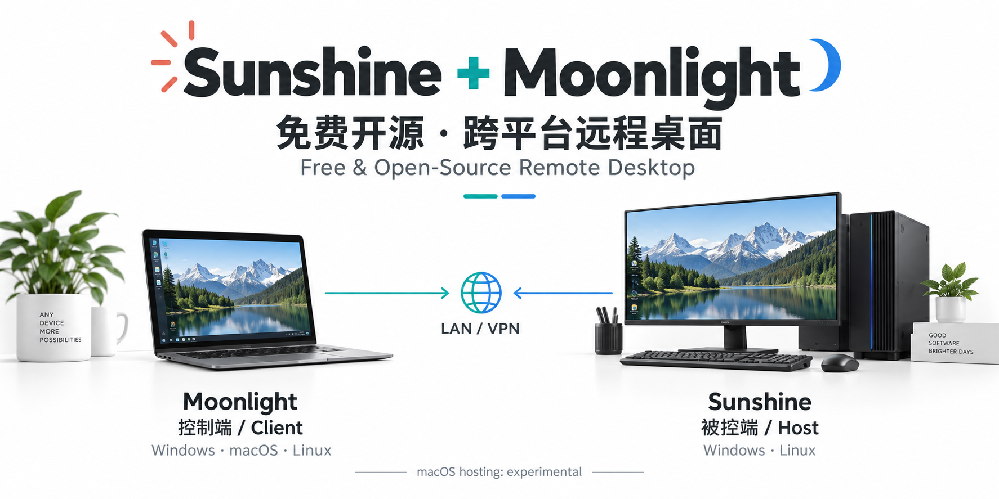

# Sunshine + Moonlight

**中文** · [English](README.en.md)



在 Mac、Windows 或 Linux 上，连接另一台电脑的完整桌面。
**Sunshine 负责共享桌面，Moonlight 负责显示和控制。**

免费开源 · 硬件加速 · 跨平台

## 平台支持

| | 控制端 · Moonlight | 被控端 · Sunshine |
| --- | --- | --- |
| Windows | 支持 | 支持；ARM64 有实验性限制 |
| macOS | 支持 Intel / Apple Silicon | 实验支持 |
| Linux | 支持 | 支持；依赖桌面会话及显卡驱动 |
| 手机 / 平板 / Apple TV | 使用对应的 Moonlight 客户端 | — |

适合编程、桌面办公和远程工作站。实际画质与延迟取决于显卡、屏幕及网络条件。

## 三步连接

1. **安装**：被控电脑安装 [Sunshine](https://github.com/LizardByte/Sunshine/releases/latest)，操作电脑安装 [Moonlight](https://github.com/moonlight-stream/moonlight-qt/releases/latest)。
2. **配对**：两端网络可达，在 Moonlight 添加电脑，并在 Sunshine 本机管理页确认 PIN。
3. **使用**：选择 **Desktop**。断开时按 `Ctrl + Alt + Shift + Q`，远端程序继续运行；Mac 使用 `Option` 对应 `Alt`。

[完整安装步骤](docs/setup.md) · [Windows 连接指南](docs/windows.md) · [Linux 会话说明](docs/linux.md)

## 官方安装包下载工具

Python 3.9+，无第三方依赖。自动选择最新稳定版并校验官方 SHA-256；**只下载，不自动安装**。

```bash
# macOS 控制端
python3 tools/download_release.py moonlight macos --download downloads

# Ubuntu 22.04 x64 被控端
python3 tools/download_release.py sunshine ubuntu22.04-amd64 --download downloads
```

```powershell
# Windows 控制端
py -3 tools/download_release.py moonlight windows --download downloads
```

其他架构、固定版本和下载选项见 [安装文档](docs/setup.md#下载工具)。

## 连接与画质

先从 **1080p / 60 FPS / 15–25 Mbps** 开始，再按屏幕和网络调整。
串流分辨率应匹配远端桌面；提高参数不等于降低延迟。

**局域网直接连接；跨网需要可达的 VPN/组网或经过批准的公网入站配置。**
软件不自带公共中继，也不会自动让校园内网电脑变成公网服务器。
不建议公开管理端口；本仓库不修改防火墙、路由或系统代理。

## 文档与许可

[Moonlight 官方指南](https://github.com/moonlight-stream/moonlight-docs/wiki/Setup-Guide) · [Sunshine 官方文档](https://docs.lizardbyte.dev/projects/sunshine/latest/)

本仓库包含独立的下载工具、示例与文档，不捆绑上游软件或任何设备配置。
原创代码与文档使用 [MIT License](LICENSE)；上游软件遵循各自许可。
基础桌面串流免费，某些可选驱动或第三方服务可能收费。

测试：`python3 -m unittest discover -s tests -v` · 发布检查：`python3 tools/check_privacy.py`
